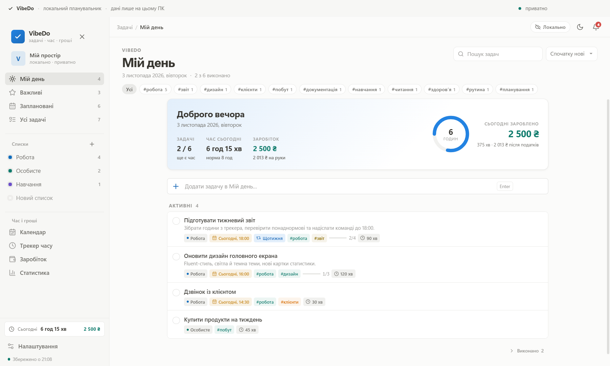
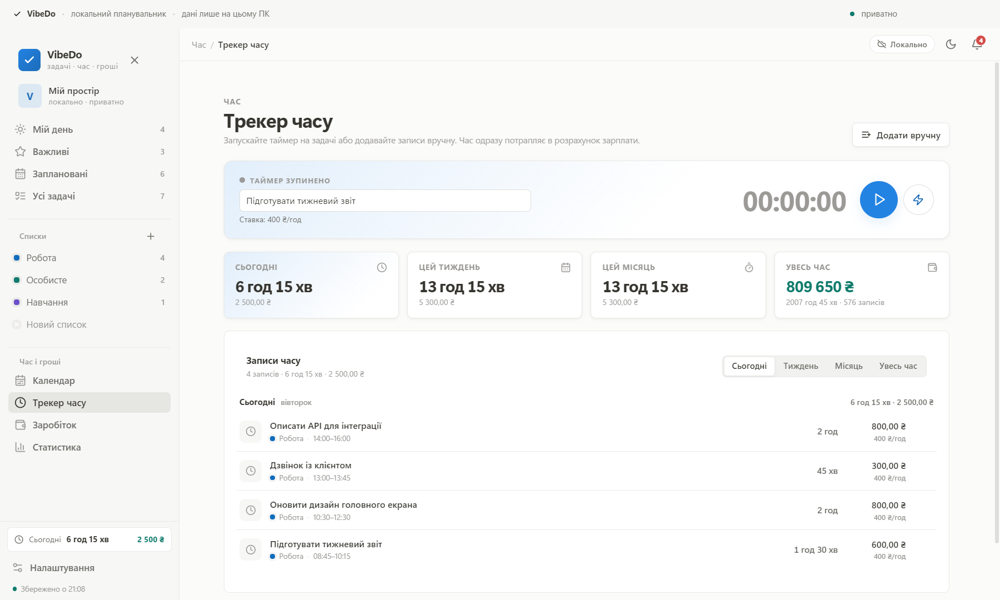
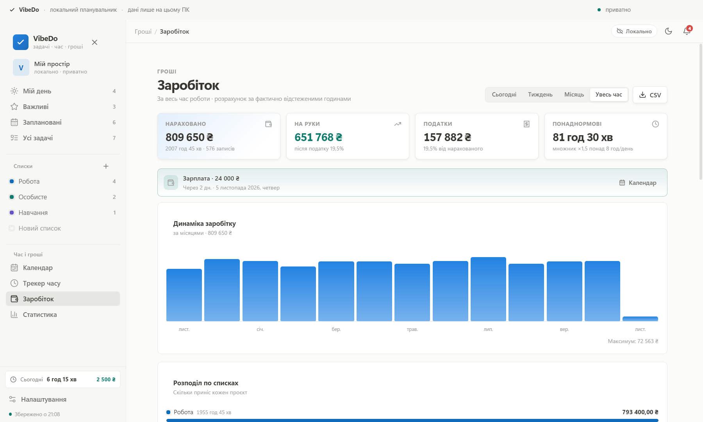
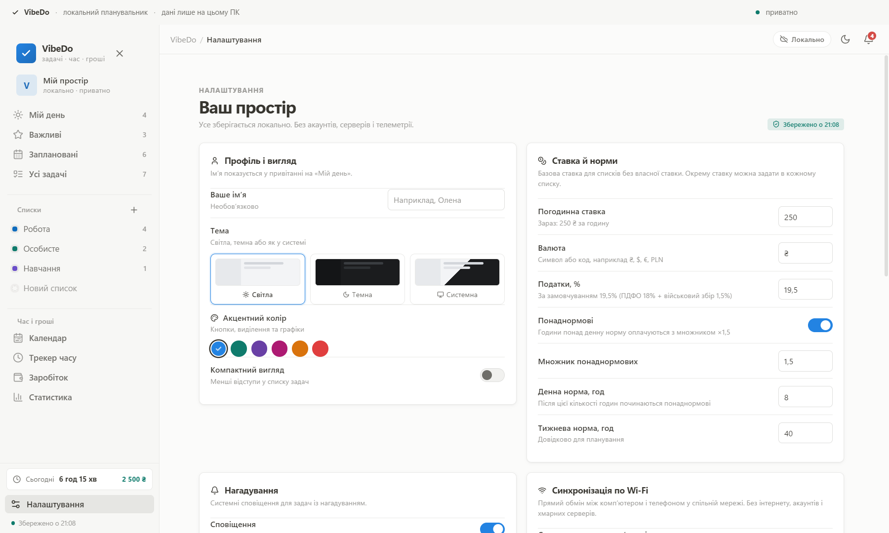
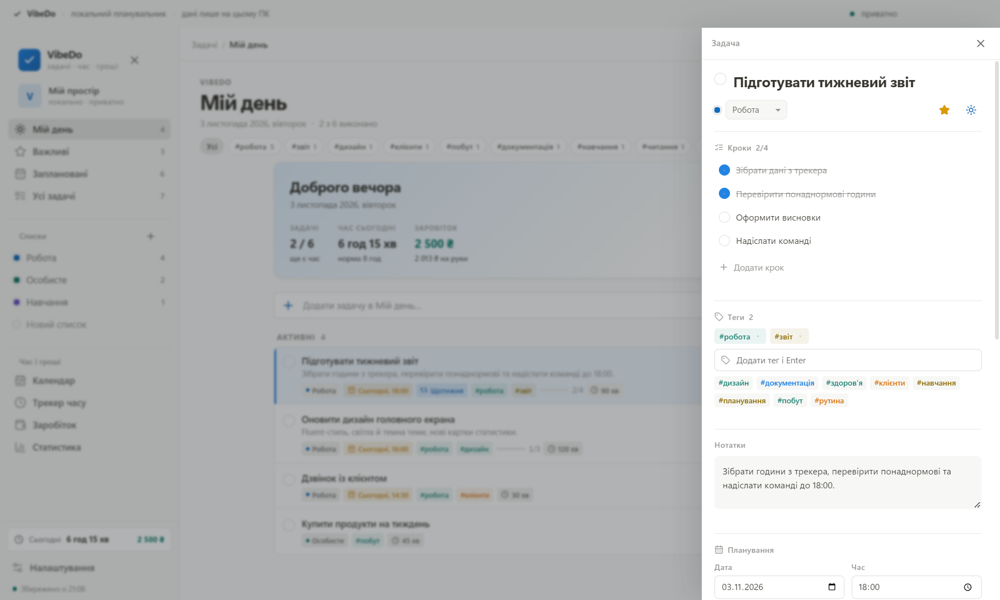

# VibeDo

**Локальний планувальник задач, трекер робочих годин і калькулятор зарплати.**  
Натхненний Microsoft To Do, але з фокусом на час і гроші. Без акаунтів, серверів, реклами й телеметрії — усі дані лежать у вас на пристрої.  
Desktop — Electron, Android — повністю нативний застосунок на Kotlin і Jetpack Compose. Синхронізація між ними — напряму по Wi-Fi, без інтернету та хмар.



## Можливості

### Задачі
- Списки з кольорами та **окремою погодинною ставкою** для кожного проєкту.
- «Мій день», «Важливі», «Заплановані», «Усі задачі».
- Кроки (підзадачі) з прогресом, нотатки, дедлайни, нагадування, оцінка часу.
- Пошук, сортування, очищення виконаних, необов’язкове ім’я для привітання.
- Швидке додавання з клавіатури.

### Час
- Один активний таймер із живим лічильником; перемикання між задачами зберігає попередню сесію.
- Ручні записи (дата, початок, тривалість, нотатка).
- Історія за день / тиждень / місяць / увесь час, групування по днях.
- Таймер переживає перезапуск застосунку — сесія відновлюється з файлу.

### Гроші
- Погодинна ставка за замовчуванням + перевизначення для кожного списку.
- **Понаднормові**: години понад денну норму множаться на налаштовуваний коефіцієнт.
- Податок у відсотках (за замовчуванням 19,5% — ПДФО + військовий збір), суми «нараховано» та «на руки».
- Агрегація за період, графік по днях/місяцях, розподіл по списках.
- Калькулятор зарплати на місяць/рік із власними параметрами.
- Експорт записів у CSV (Excel-сумісний, `;` + BOM).

### Дані та приватність
- Усі задачі, записи часу й налаштування — у **`vibedo-data.json`** у папці застосунку.
- Шлях на Windows: `%APPDATA%\vibedo\vibedo-data.json`.
- Атомарний запис (temp-файл → rename), автозбереження після змін.
- Щоденні резервні копії в `backups/` (останні 14).
- Експорт/імпорт JSON, кнопка «Відкрити папку з даними», повне скидання.
- Жодних фонових мережевих запитів. Єдиний виняток — синхронізація, яку ви запускаєте вручну в локальній мережі.

### Синхронізація по Wi-Fi
- Прямий обмін між комп’ютером і телефоном у спільній Wi-Fi мережі.
- Підключення за PIN-кодом, одноразовий bearer-токен, порт `47823`.
- Злиття даних за `updatedAt`: новіші записи перемагають, записи без змін не дублюються.
- Працює офлайн, без акаунтів і хмарних серверів. Видалені записи можуть повернутися з іншого пристрою — це особливість злиття без центрального сервера.

### Android
- Повністю нативний інтерфейс на Jetpack Compose: без WebView і Capacitor у роботі застосунку. WebView створюється лише один раз під час міграції, щоб прочитати старі дані 1.0.1.
- Ті самі екрани, що й на desktop: «Мій день», список, календар, час, заробіток, статистика, налаштування.
- Системні нагадування через AlarmManager, включно з Pomodoro.
- Автоматична міграція даних із версії 1.0.1 під час першого запуску.
- Мінімальна версія Android 8.0 (API 26).

### Інтерфейс
- Fluent-подібний дизайн, світла/темна/системна тема, 6 акцентних кольорів.
- Компактний режим, адаптивна бічна панель, деталі задачі у висувній панелі.
- Гарячі клавіші: `Ctrl+N` — нова задача, `Ctrl+F` — пошук.

## Скріншоти

**Трекер часу**



**Заробіток**



**Налаштування**



**Деталі задачі**



## Технології

- **Electron 33** — десктопне вікно, доступ до файлової системи через IPC.
- **React 18 + TypeScript + Vite 6** — інтерфейс desktop і web.
- **Zustand** — стан застосунку.
- **date-fns** — дати й періоди.
- **lucide-react** — іконки.
- **Kotlin 1.9 + Jetpack Compose** — нативний Android-застосунок.
- **electron-builder + resedit** — пакування, іконка та метадані `.exe`.
- Без UI-фреймворку й без зовнішніх шрифтів: усе працює офлайн.

## Швидкий старт

Потрібен Node.js 20+ (перевірено на Node 22, Windows 11).

```bash
npm install

# Десктопний режим із гарячим перезавантаженням
npm run dev

# Лише веб-версія в браузері (дані в localStorage)
npm run dev:web

# Перевірка типів
npm run typecheck

# Продакшн-збірка рендерера
npm run build

# Запуск зібраного застосунку
npm start
```

### Збірка .exe

```bash
npm run dist
```

Результат у `release/`: інсталятор `VibeDo-Setup-1.0.2-x64.exe` і portable-версія `VibeDo-Portable-1.0.2-x64.exe`.  
Збірка не підписана сертифікатом, тому Windows SmartScreen може показати попередження під час першого запуску.

### Збірка Android APK

Потрібен JDK 17 та Android SDK 34. Шляхи задаються змінними `JAVA_HOME` і `ANDROID_HOME`.

```bash
# Debug APK
npm run android:debug

# Підписаний release APK
npm run android:release
```

Результат: `android/app/build/outputs/apk/release/app-release.apk`.  
Для підпису release-збірки створіть власний ключ і скопіюйте `android/keystore.properties.example` у `android/keystore.properties`. Ключ і паролі не зберігаються в репозиторії. Якщо підпису немає, Gradle збереже unsigned APK. Оновлення поверх попередньої версії встановлюється лише з тим самим ключем.

## Як рахується зарплата

Для кожного запису часу:

```
ставка = ставка списку (якщо задана) або ставка з налаштувань
години = секунди / 3600
```

Понаднормові рахуються послідовно в межах календарного дня:

```
перші dailyNormHours годин      → ставка
усі наступні години             → ставка × overtimeMultiplier
```

Податок застосовується до загальної суми:

```
нараховано = Σ(звичайні години × ставка + понаднормові × ставка × множник)
податки    = нараховано × taxPercent / 100
на руки    = нараховано − податки
```

Якщо понаднормові вимкнено, усі години оплачуються за базовою ставкою.  
Калькулятор на сторінці «Заробіток» — окремий прогноз: `ставка × години × дні + понаднормові`, він не змінює фактичні записи.

## Де лежать дані

| Що | Де |
|---|---|
| Основні дані (Windows) | `%APPDATA%\vibedo\vibedo-data.json` |
| Резервні копії (Windows) | `%APPDATA%\vibedo\backups\YYYY-MM-DD.json` |
| Основні дані (Android) | `/data/data/com.vibedo.app/files/vibedo-data.json` (внутрішня пам’ять застосунку) |
| CSV-експорт | Обираєте місце через діалог збереження |

У веб-режимі (`npm run dev:web`) дані зберігаються в `localStorage` браузера.  
Щоб перенести їх у десктопну версію: експортуйте JSON у веб-версії та імпортуйте в застосунку.

## Структура

```
electron/
  main.cjs          головний процес, вікно, IPC, файли, бекапи
  preload.cjs       безпечний місток contextBridge
  sync-server.cjs   LAN-сервер синхронізації
src/
  components/       Sidebar, TaskView, TaskDetails, TimerBar, діалоги, UI
  pages/            TimePage, SalaryPage, SettingsPage
  lib/              utils (гроші/час/періоди), storage, persist, sync
  store.ts          модель даних і дії Zustand
  styles.css        дизайн-система та всі стилі
android/
  app/src/main/java/com/vibedo/app/
    data/           модель, JSON, файли, синхронізація, міграція
    ui/             Compose-екрани та компоненти
    notifications/  AlarmManager, канали, boot receiver
scripts/            іконка, демо-дані, знімки для документації, afterPack
```

## Обмеження

- Один активний таймер (як у більшості трекерів).
- Запис, що перетнув північ, зараховується до дня початку.
- Понаднормові рахуються по календарних днях, а не по робочому графіку.
- Нагадування на desktop працюють, поки застосунок запущений; на Android — через системні AlarmManager-нагадування.
- Синхронізація працює лише в межах однієї локальної мережі. Центрального сервера немає, тому видалення не синхронізуються як tombstones і можуть повернутися з іншого пристрою.

## Ліцензія

MIT. Використовуйте, змінюйте, розповсюджуйте безкоштовно. Див. [LICENSE](LICENSE).
